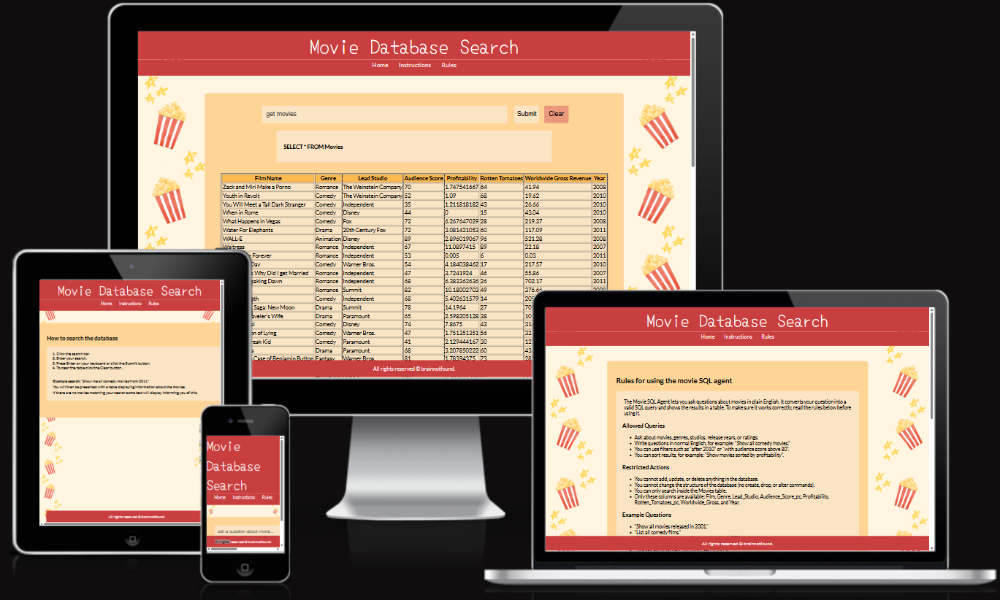

# team404-sql-agent

This project, developed collaboratively by team-404, translates natural language into queries to retrieve data
from a centralised database.

## Project Objectives
- An embedded H2 database seeded at startup by parsing and loading a CSV dataset via plain JDBC.
- A Google ADK powered Java client that takes natural language questions, translates them into safe SQL SELECT statements,
and executes them against that database.
## Technologies Used
- Java
- H2 Database
- Docker
- Google Cloud Platform (GCP)
- HTML
- CSS
- JavaScript
